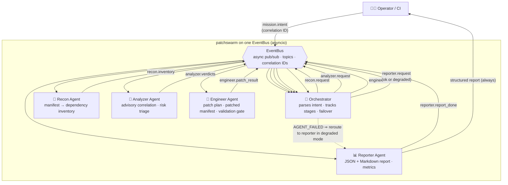
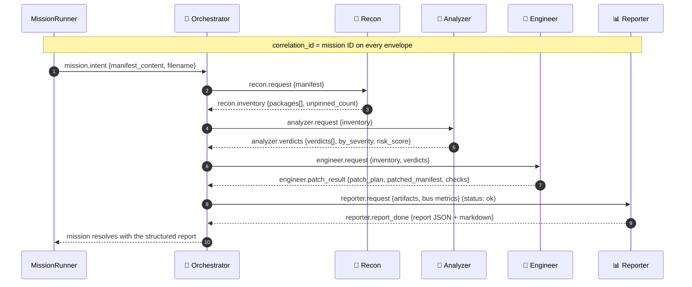
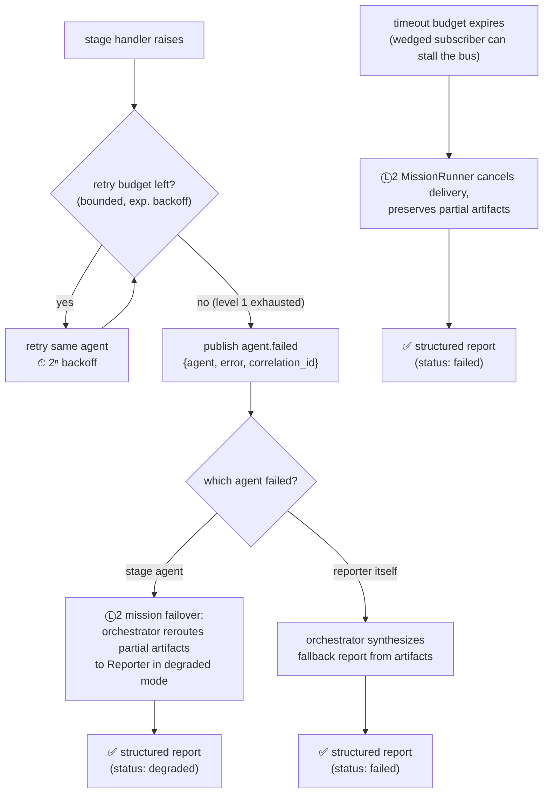

# patchswarm 🐝🛡️

**An autonomous five-agent swarm that hunts vulnerable dependencies, plans pinned patches behind a validation gate, and always - even mid-failure - returns a structured report.**

`patchswarm` ingests a dependency manifest (`requirements.txt` or `package.json`), and a crew of five specialized agents - Orchestrator, Recon, Analyzer, Engineer and Reporter - collaborates in real time over an async pub/sub event bus to scan, triage, patch and audit it. Every message on the bus carries a correlation ID, so multiple missions can share one swarm without cross-talk. Two levels of error recovery guarantee that a mission never ends silently: agent-level bounded retries, and mission-level failover with a timeout budget that degrades into a structured report instead of crashing.

Zero runtime dependencies. Pure Python 3.9+ standard library - `asyncio` is the only "framework" here.

---

## Why it exists

Dependency vulnerabilities are a *coordination* problem, not a scanning problem. Scanners already tell you "you're on requests 2.25.1" - what teams actually lack is a *coordinated, recoverable pipeline* that goes end-to-end:

1. **Find** what you actually depend on (including unpinned floats).
2. **Triage** what's exploitable and how badly, with one risk number a lead can act on.
3. **Fix** it with a minimal-blast-radius patch plan that passes a validation gate.
4. **Prove** it happened, in an auditable artifact (JSON + Markdown) even when things break midway.

Orchestrating those concerns in one monolithic script couples them forever; `patchswarm` models each concern as an autonomous agent with a narrow contract, wired together by topics - so each stage can be tested, replaced, retried or skipped without touching its peers. The architecture is also an explicit study in **graceful degradation**: a security pipeline that crashes invisibly is worse than one that reports "here is the partial triage and why it stopped."

It succeeds [sentinel-swarm](https://github.com/mehulpatel23b-pixel/sentinel-swarm) (async event-bus SOC) and [reforge](https://github.com/mehulpatel23b-pixel/reforge) (autonomous refactoring crew) as the third architecture study in this series, this time aimed at **supply-chain vulnerability response**.

---

## Architecture at a glance



### Sequence of a mission



### Two-level error recovery

The guarantee: **mission end ⇒ structured report, no exceptions.**



- **Level 1 (`BaseAgent.receive`)** - every handler runs inside a bounded retry loop (default 2 retries, exponential backoff). Only after the budget is exhausted does the agent publish `agent.failed` with a machine-readable cause.
- **Level 2 (Orchestrator + `MissionRunner`)** - the Orchestrator reroutes whatever artifacts survived to the Reporter in `degraded` mode; if the Reporter is the thing that died, the Orchestrator synthesizes the report itself; and even a wedged subscriber can't stall the mission because `MissionRunner` fires its intent through its own task, enforces the timeout budget, and cancels stuck delivery work on completion. Partial artifacts survive into every fallback path.

---

## The crew

| Agent | Bus topics | Responsibilities | Failure mode |
| --- | --- | --- | --- |
| 🧠 **Orchestrator** | `mission.intent`, stage results, `agent.failed`, `reporter.report_done` | Parses intent into a concrete plan, delegates each phase, tracks artifacts + events per correlation ID, initiates failover | If *it* dies, MissionRunner's timeout still produces a structured report |
| 📡 **Recon** | `recon.request` → `recon.inventory` | Parses `requirements.txt` / `package.json` (comments, markers, caret/tilde ranges), flags unpinned floats as worst-case exposure | Retries, then `agent.failed` → degraded report |
| 🔬 **Analyzer** | `analyzer.request` → `analyzer.verdicts` | Correlates inventory against the bundled advisory DB, scores severity (0-100 risk with criticality bonus), orders findings most-severe-first | Retries, then `agent.failed` → degraded report |
| 🔬→🔧 **Engineer** | `engineer.request` → `engineer.patch_result` | Minimum-blast-radius patch plan (dedup per package, most-severe advisory governs), rewrites a fully-pinned manifest, runs the validation gate (`upgrades_sufficient`, `artifact_integrity`, `explicit_pinning`) | Retries; failure still reports partial triage |
| 📊 **Reporter** | `reporter.request` → `reporter.report_done` | Compiles JSON + Markdown audit report with metrics, findings, patch plan, validation results and error/degradation trail | Orchestrator synthesizes a fallback report in its place |

Every envelope: `{topic, payload, sender, correlation_id, attempts, ts, message_id}`.

---

## Installation

```bash
# from source, no dependencies to install
git clone https://github.com/mehulpatel23b-pixel/patchswarm.git
cd patchswarm
pip install -e .        # optional, for the `patchswarm` CLI entry point
```

Requirements: Python ≥ 3.9. Nothing else - `asyncio` is in the standard library.

## Quick start

```python
import asyncio
from patchswarm import MissionRunner

UNSAFE = "requests==2.25.1\nflask==2.0.1\npyyaml>=4.0\n"

report = asyncio.run(
    MissionRunner().run({"manifest_content": UNSAFE, "filename": "requirements.txt"})
)

print(report["status"])                          # 'ok'
print(report["metrics"]["vulnerabilities_found"]) # 3
print(report["patched_manifest"])                 # fully pinned, patched requirements
print(report["markdown"])                         # human-readable audit report
```

Or from the CLI:

```bash
PYTHONPATH=src python3 -m patchswarm requirements.txt            # Markdown report
PYTHONPATH=src python3 -m patchswarm package.json --json          # JSON report
PYTHONPATH=src python3 -m patchswarm requirements.txt --dry-run   # plan only
```

Run the bundled demo (two healthy missions + one that exercises failover):

```bash
PYTHONPATH=src python3 examples/demo.py
```

## Tests

```bash
python3 -m pytest tests -q
```

34 tests cover the bus (fan-out, correlation-ID threading, error isolation), domain math (version comparison, affected-specs, risk scoring, plan dedup), full missions (Python + JS manifests, dry-run, clean manifests, concurrent missions on one bus), and the full recovery ladder (retry-then-succeed, `agent.failed` signalling, degraded failover, reporter-down fallback, wedged-subscriber timeout, rejected intents). The async test harness itself is dependency-free - `tests/conftest.py` runs coroutine tests via `asyncio.run`, so plain pytest just works.

---

## Real-world use cases

| Scenario | How patchswarm handles it |
| --- | --- |
| **Nightly CI supply-chain gate** | Run `patchswarm requirements.txt --json` as a scheduled job; non-zero exit + degraded/failed status pages the on-call with the partial triage already attached |
| **Pre-merge dependency review** | Engineer's patch plan gives reviewers the *minimal* upgrade set with advisory IDs - review the plan, not the diff soup |
| **Incident response on a flagged advisory** | Hand the offending manifest to the swarm; Analyzer's severity-first ordering + risk score tell you what else in the same project rides along |
| **Unpinned-float hygiene** | Recon treats unpinned dependencies as worst-case; the patched artifact comes back fully pinned (`explicit_pinning` check) |
| **Monorepo triage** | Run concurrent missions (one per manifest) on a single swarm - correlation IDs keep every artifact isolated |
| **Audit / compliance trail** | Every mission ends with a stable JSON report shape + a Markdown rendering, including error and degradation trails - evidence, not vibes |
| **Researching multi-agent patterns** | Correlation-ID pub/sub, two-level recovery and always-report semantics are directly transferable to any staged automation, from cloud audits to log forensics |

---

## Design principles

1. **The report is the contract.** Whatever happens, a mission ends with a parseable, stable-shaped structured report. Degraded and failed statuses are outcomes, not exceptions.
2. **Zero dependencies, zero excuses.** A supply-chain tool that itself pulls 30 transitive dependencies would be its own finding. The bus, the semver math, the report renderer - all stdlib.
3. **Narrow agent contracts.** Each agent speaks only through envelopes and one domain task. Any agent can be replaced (the tests do exactly this with sabotage agents) without touching peers.
4. **Correlation IDs over shared state.** Missions don't mutex; they thread identity through every envelope, so concurrent missions are safe by construction.
5. **Minimal blast radius.** Only packages with active findings are upgraded, straight to the advisory floor version; the patched artifact is fully pinned, the smallest contract everything downstream understands.
6. **Recovery is architecture, not an afterthought.** Retry budgets live in the agent base class, failover lives in the Orchestrator, timeout enforcement lives in the MissionRunner - three layers, tested independently.

## Project structure

```
patchswarm/
├── src/patchswarm/
│   ├── __init__.py            # public API: EventBus, Envelope, Topics, MissionRunner
│   ├── __main__.py            # CLI: python -m patchswarm <manifest> [--json] [--dry-run]
│   ├── bus.py                 # async pub/sub EventBus with delivery metrics
│   ├── messages.py            # Envelope + canonical topic registry
│   ├── manifest.py            # requirements.txt / package.json parsing, version math
│   ├── advisories.py          # bundled offline advisory database (swap for OSV in prod)
│   ├── report.py              # structured report builder + Markdown renderer
│   ├── mission.py             # MissionRunner: timeout, failover, always-report guarantee
│   └── agents/
│       ├── base.py            # BaseAgent: subscriptions + level-1 retry ladder
│       ├── orchestrator.py    # intent parsing, delegation, level-2 failover
│       ├── recon.py           # manifest → inventory
│       ├── analyzer.py         # advisory correlation + risk triage
│       ├── engineer.py        # patch plan + patched artifact + validation gate
│       └── reporter.py        # JSON + Markdown mission report
├── tests/                     # 34 tests: bus, domain math, missions, recovery ladder
├── examples/demo.py           # end-to-end demo incl. a failover mission
├── pyproject.toml             # packaging, zero runtime deps
├── LICENSE                    # MIT
└── README.md
```

## License

Released under the MIT License - see [LICENSE](LICENSE). Copyright (c) 2026 Mehul Patel.

The bundled advisory database is illustrative sample data for offline demos; for real-world use, wire `advisories.py` to a live feed such as [OSV](https://osv.dev) or GitHub Security Advisories - the record shape maps one-to-one.

---

*Part of a daily series exploring high-impact multi-agent architectures. Built autonomously by Susu, the author's personal AI agent.*
